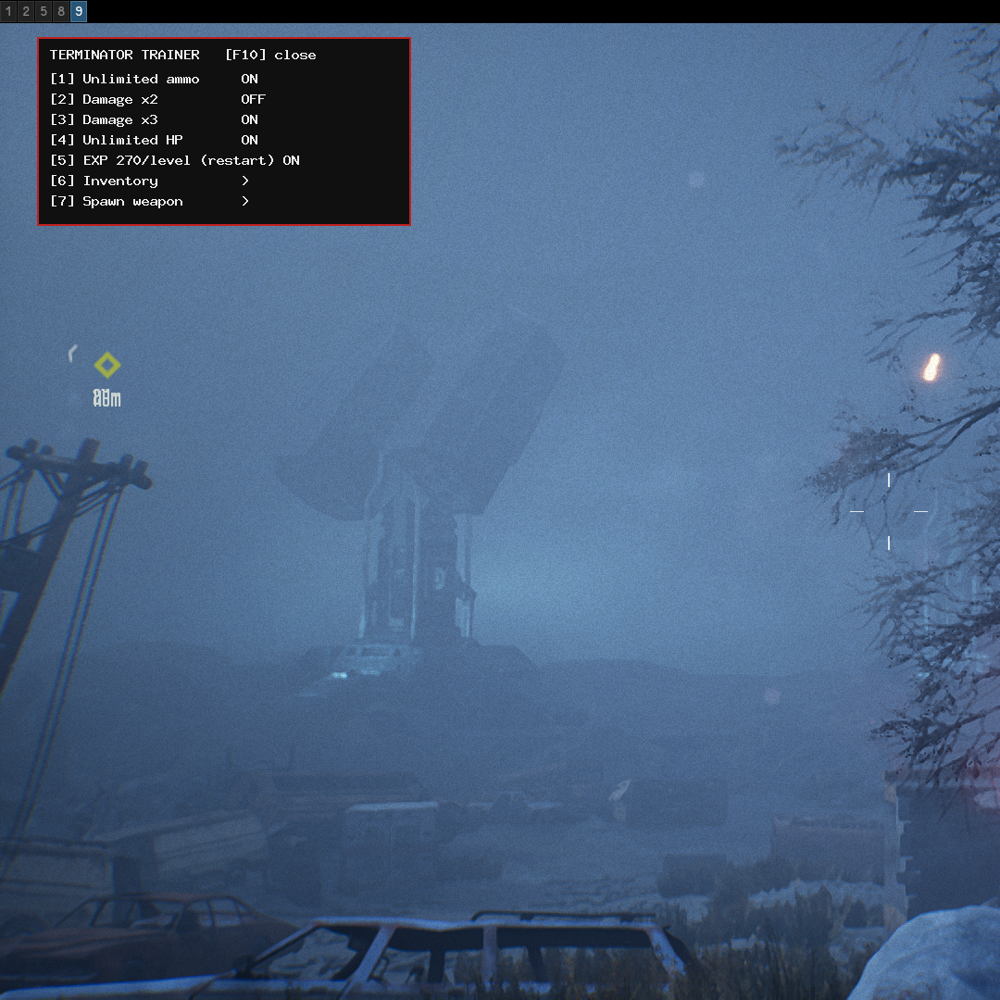
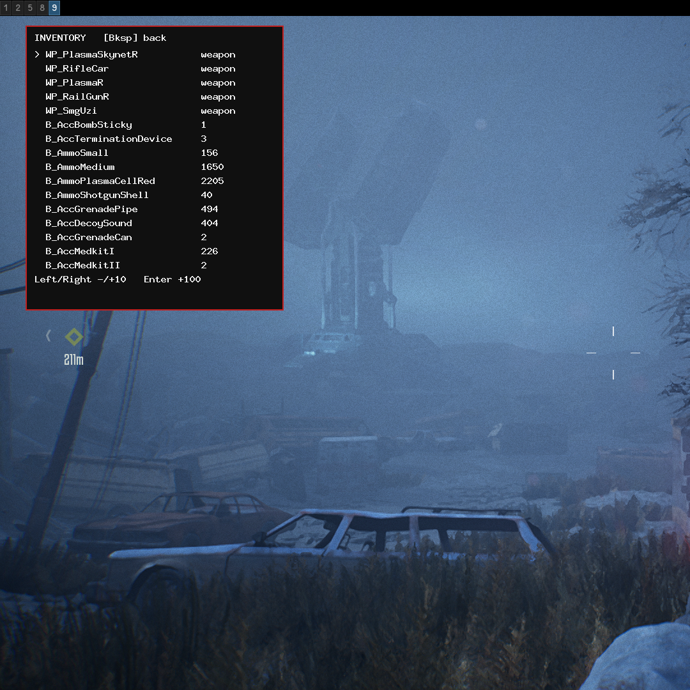
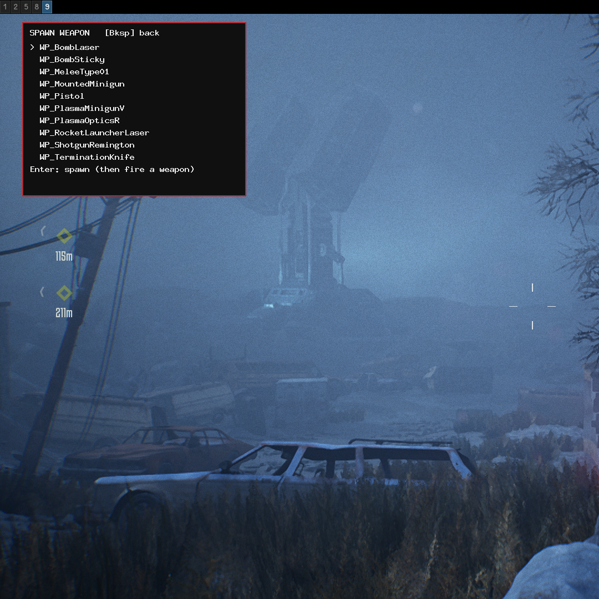
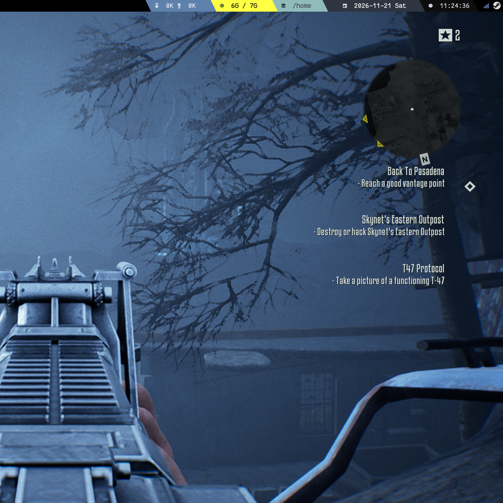
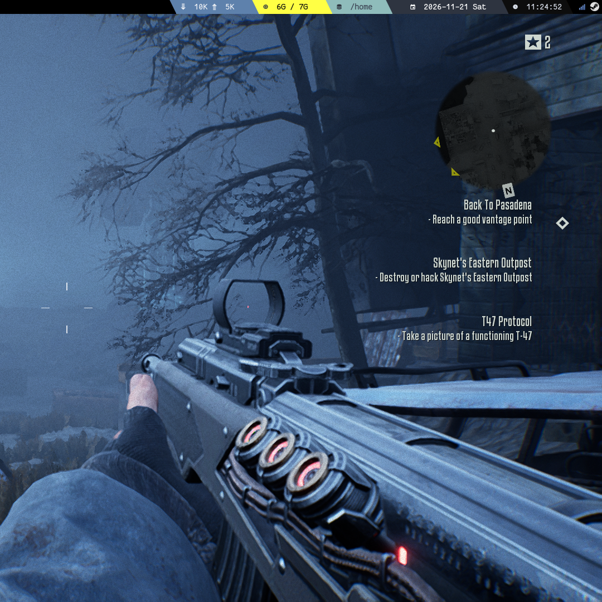
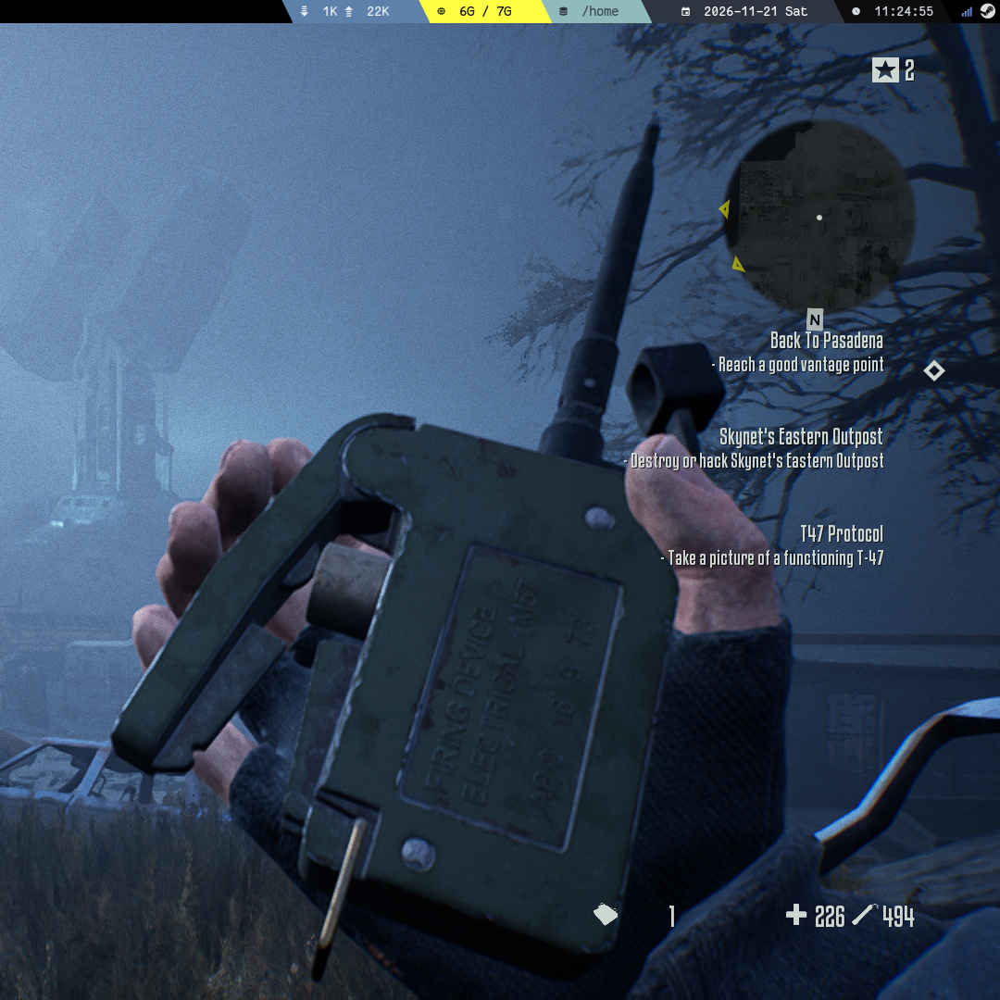
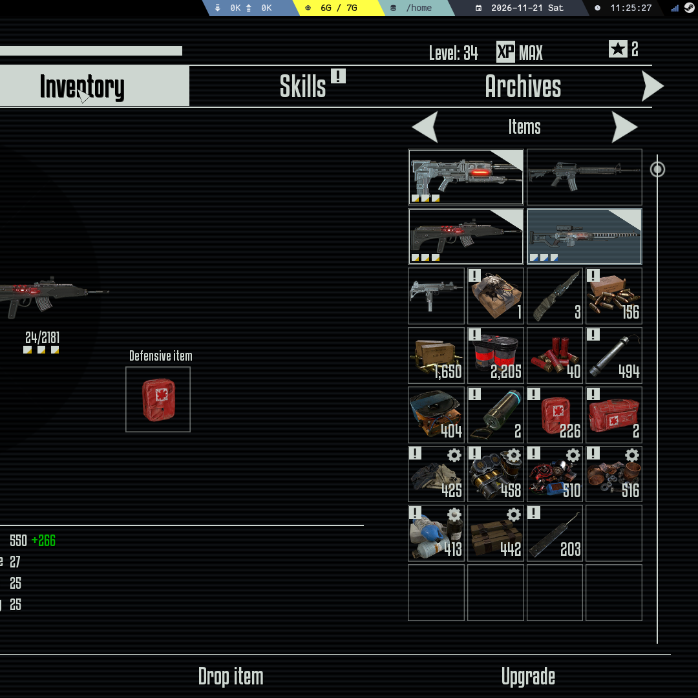
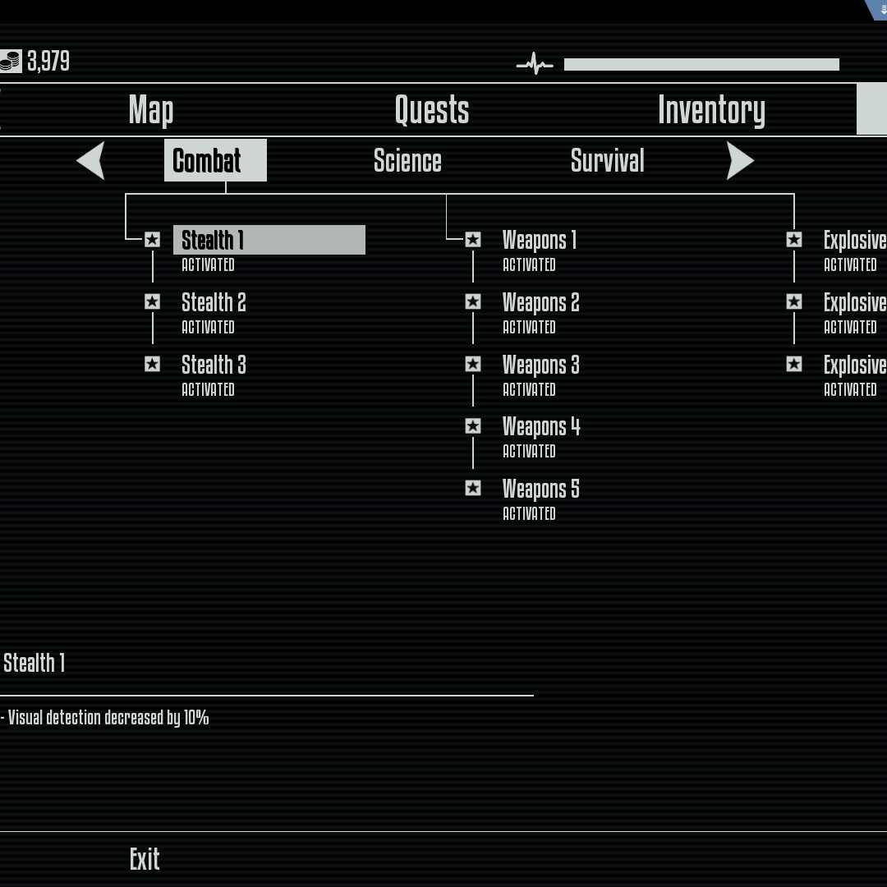
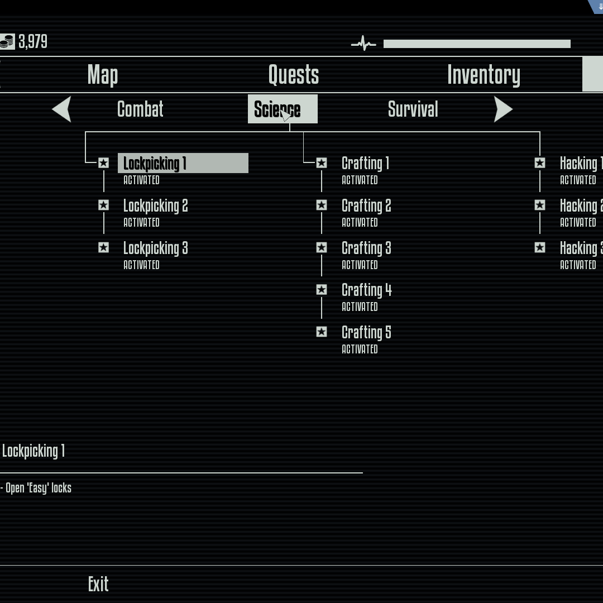
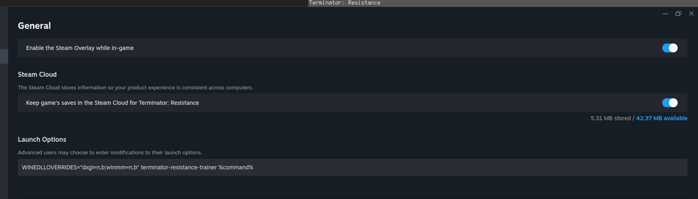

# Terminator: Resistance Trainer (Linux)

F10 cheat menu for Terminator: Resistance on Linux (Steam + Proton, X11).
Single player only.

|                                                   |                                                 |                                             |
| ------------------------------------------------- | ----------------------------------------------- | ------------------------------------------- |
|         |  |      |
| F10 menu, cheats on                               | Inventory page                                  | Spawn weapon page                           |
|                |      |  |
| Aiming show off                                   | Weapon                                          | Weapon                                      |
|  |      |  |
| In-game inventory                                 | Skills                                          | Skills                                      |

Only for Linux, tested in Linux: Devuan GNU/Linux 6 (excalibur) x86_64

## Features

| Key   | What                                     |
| ----- | ---------------------------------------- |
| 1     | Unlimited ammo                           |
| 2 / 3 | Damage x2 / x3 (enemies only)            |
| 4     | Unlimited HP                             |
| 5     | EXP 270 per level (needs a game restart) |
| 6     | Inventory item spawn                     |
| 7     | Spawn weapon                             |

## Requirements

- Linux, Terminator: Resistance installed (Proton)
- X11 session (the menu does not work on pure Wayland)
- [mise](https://mise.jdx.dev)
- `git`
- `~/.local/bin` in your PATH (or use the full path in the launch option)

## Install

With [mise](https://mise.jdx.dev):

```sh
mise use -g github:selene466/terminator-resistance-trainer-linux@latest
```

Or build from source (Go 1.27+):

```sh
git clone https://github.com/selene466/terminator-resistance-trainer-linux
cd terminator-resistance-trainer-linux
mise install
mise install-local
```

Steam > right click Terminator: Resistance > Properties > General > Launch Options:

```
terminator-resistance-trainer %command%
```



"command not found"? Use the full path: `/home/YOURNAME/.local/bin/terminator-resistance-trainer %command%`

Start the game, load into a level, press **F10**.

Launch option (mise puts a shim here):

```
~/.local/share/mise/shims/terminator-resistance-trainer %command%
```

Update later with `mise upgrade`.

## Use

- **F10** opens and closes the menu. Press the number key of a line to switch it ON or OFF.
- Cheats only work inside a level, not in the main menu.
- **EXP (5):** press 5 to turn it ON, then fully quit and restart the game. It is a game file change, it cannot be applied live.
- **Inventory (6):** Up/Down select, Left/Right change amount by 10, Enter adds 100, Backspace goes back. Ammo and items only, weapons have no amount.
- **Spawn weapon (7):** Up/Down select, Enter, then fire any weapon once. The new weapon appears in your inventory with 200 ammo.
- Open the game's own inventory and skills with **Tab**.

## If something is wrong

- **F10 does nothing:** the launch option is wrong or the game was not started from Steam. Check `~/.cache/terminator-trainer.log`.
- **A cheat shows an error:** load into a level first, then try again.
- **After a game update** cheats may refuse to apply (they check exact code patterns and stop instead of guessing).
- **Remove EXP mod:** press 5 to turn it OFF, restart the game.

## Develop

    mise run build      # -> dist/terminator-resistance-trainer
    mise run vet
    python3 -I tools/mkexp.py "<game>/Terminator/Content/Paks" 270   # rebuild the EXP pak from the game's own asset

Layout: `cmd/` entry point, `internal/trainer` memory patches, `internal/ui` menu, `internal/mod` EXP pak (`exp.pak` and unpacked `exp/`).

## License

[MIT](LICENSE). This covers the trainer code and tools. `internal/mod/exp.pak`, `internal/mod/exp/` and the screenshots contain material from Terminator: Resistance and belong to its owners, not covered by the MIT license.
